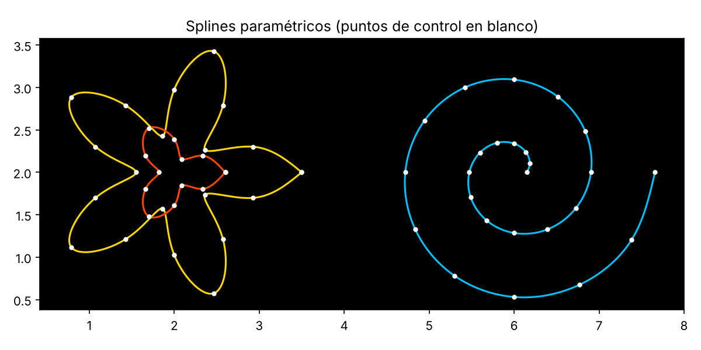

# Splines cúbicos paramétricos desde cero

Implementación en Python, sin usar las rutinas de interpolación de SciPy, de splines cúbicos paramétricos $(x(t), y(t))$ para dibujar curvas cerradas a partir de una lista de puntos de control.



## Qué hace

Dada una secuencia de puntos del plano, construye una curva suave que pasa por todos ellos:

1. **Parametrización:** cada coordenada se trata por separado como función del parámetro $t = 1, 2, \dots, n$.
2. **Derivadas en los nodos:** se plantea un sistema lineal tridiagonal para obtener las derivadas que garantizan continuidad $C^2$.
3. **Resolución del sistema:** factorización **LU** (variante de **Doolittle**) con sustitución hacia delante y hacia atrás, implementada a mano.
4. **Polinomio en cada tramo:** interpolación de **Hermite** mediante tablas de **diferencias divididas** con nodos repetidos.
5. **Evaluación:** cada polinomio se evalúa con la **regla de Horner**.

## Estructura

| Archivo | Contenido |
|---|---|
| `splines.py` | Todas las funciones: LU, cálculo de derivadas, Hermite, Horner y dibujo |
| `splines_hermite.ipynb` | Notebook original de la práctica, con un dibujo compuesto por 60 splines cerrados |
| `demo.py` | Ejemplo mínimo: dibuja una flor y una espiral y comprueba el solver LU frente a NumPy |

## Cómo ejecutarlo

```bash
pip install numpy matplotlib
python demo.py        # genera demo.png
```

O abre `splines_hermite.ipynb` en Jupyter para ver el dibujo completo.

## Contexto

Práctica de métodos numéricos del Doble Grado en Ingeniería Informática y Matemáticas (Universidad de Granada), realizada en pareja por Miguel Ángel Fernández y Cristina.

**Tecnologías:** Python, NumPy, Matplotlib
